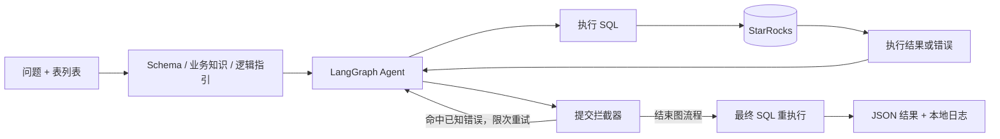

# TGAC 2025 · Text-to-SQL Agent

**用业务逻辑指引和 SQL 执行反馈，把自然语言分析需求转成可执行查询。**

[](https://github.com/Huber66/tgac-2025-text2sql-agent/actions/workflows/ci.yml)
[](LICENSE)


中文 · [English](README.en.md) · [方案解读](docs/solution.md) · [逐步演示](docs/walkthrough.md) · [完整复现](docs/reproduction.md) · [项目导览](docs/project-guide.md)

本项目源于 **2025 腾讯游戏算法大赛（TGAC）赛道三：数智决策科学**，针对游戏数据分析中的业务口径、多表关联与复杂 SQL 生成问题，采用 **Python + LangGraph + DeepSeek + StarRocks** 实现单 Agent 的规划、查询、修正与提交闭环。[比赛介绍](https://www.competehub.dev/zh/competitions/tgac_03) · [赛事官网](https://tgac.tencent.com/)

公开版本保留核心实现，并附两道完全自造的演示题。**首次运行无需比赛资料，也无需 API 密钥**；让模型重新解题时才需要配置 DeepSeek。

## 核心设计

原始方案面对的约束是有限的 Golden SQL 参考样本，以及混合、含噪的 Mock 数据。单靠字段名容易漏掉业务口径，SQL 语法正确也可能选错日期或统计人群。因此方案把重点放在**先查询数据验证假设、注入业务逻辑指引、利用执行和结果反馈修正**。路线选择与知识来源详见[方案设计](docs/solution.md)。

| 模块 | 实现方式 | 解决的问题 |
| --- | --- | --- |
| Schema 上下文 | 按题目提供的 `table_list` 提取表结构 | 缩小上下文范围，减少无关表干扰 |
| 逻辑指引注入 | 将逐题业务规则与通用知识拼入 Prompt | 补充字段含义、日期口径和关联约束 |
| SQL 执行反馈 | 通过工具查询真实数据，将报错交回 Agent 修正 | 校验假设，修复 SQL 语法和执行错误 |
| 错误结果拦截 | 对查询结果生成指纹，与已知错误样本比较 | 提醒模型避开已经出现的错误路径 |
| 最终重执行 | 提交后重新执行最终 SQL，再保存实际结果 | 保证提交 SQL 与输出结果来自同一次查询 |
| 缓存与日志 | 正确答案 SQL 复用、逐步 SQL/结果/消息记录 | 支持回归验证与问题定位 |



拦截器根据历史错误样本检查提交结果，并通过限次重试反馈引导查询修正。具体分支见[架构说明](docs/architecture.md)。

除了单题运行，项目还包含运行之间的知识维护：根据外部评测或复核结果，通过管理工具更新正确、错误样本，再从参考 SQL 或待分析题目中提炼 Logic Guide。[知识维护流程与代码对应](docs/solution.md#运行时流程与知识维护流程)

## 阅读入口

| 想了解什么 | 推荐入口 |
| --- | --- |
| 为什么选择 Agent 与语境工程 | [方案解读](docs/solution.md) |
| 图流程、工具和提交策略如何实现 | [架构与代码对应](docs/architecture.md) |
| 一次错误如何被拦截、修正并输出 | [逐步演示](docs/walkthrough.md) |
| 如何阅读代码并运行各类示例 | [项目导览](docs/project-guide.md) |

## 快速运行：不调用模型的公开演示

需要 **Python 3.12、Docker Desktop 或 Docker Engine + Compose**。数据库容器上限为 4 GB，不需要 GPU。

```bash
git clone https://github.com/Huber66/tgac-2025-text2sql-agent.git
cd tgac-2025-text2sql-agent
python -m venv .venv
```

激活虚拟环境：Windows PowerShell 使用 `.\.venv\Scripts\Activate.ps1`；Linux/macOS 使用 `source .venv/bin/activate`。

```bash
pip install -r requirements-lock.txt
docker compose up -d --wait --wait-timeout 240
python reset_and_init_db.py --mode init
python main.py --cache_only
python scripts/verify_demo.py
```

首次初始化会建立独立的 `tgac_demo` 数据库。默认端口是 **19030**；后续重复演示直接执行最后两条命令即可，无需重复初始化。

预期校验输出：

```text
[PASS] sql_1
[PASS] sql_2
```

| 自造演示题 | 关键逻辑 | 预期结果 |
| --- | --- | --- |
| `sql_1`：回流玩家各游戏总时长 | 标签快照过滤、双表关联、分组聚合 | `g_alpha: 75`，`g_beta: 60` |
| `sql_2`：次日留存 | `LEFT JOIN`、玩家去重、比率计算 | 活跃 4 人，留存 2 人，留存率 `0.5` |

结果位于 `output/demo/dataset_exe_result.json`，格式示例见 [examples/demo_result.json](examples/demo_result.json)。

## 不调用模型的闭环回放

数据库初始化完成后，可以观察一次包含错误结果拦截的实际图执行：

```bash
python scripts/replay_demo.py
python scripts/verify_demo.py --file output/demo/replay_result.json --ids sql_1
```

脚本依次执行侦察查询、故意使用错误日期的 SQL、提交拦截、修正规划、正确查询与最终提交。**工具调用顺序与 SQL 已预设，数据库访问和拦截器实际运行，不调用模型 API。** 总计 6 次工具调用、4 次 SQL 查询，输出轨迹位于 `output/demo/replay_trace.json`。

[逐步说明与时序图](docs/walkthrough.md) · [一次已核验的自造数据轨迹](examples/replay_trace.json)

## 让 DeepSeek 重新生成 SQL

把 `.env.example` 复制为 `.env`，填写 `DEEPSEEK_API_KEY`。默认模型为 `deepseek-flash`，可通过 `DEEPSEEK_MODEL` 或 `--model_name` 修改。

```bash
python main.py --ignore_cache --rerun_ids sql_1 --max_workers 1 --output_file output/demo/agent_result.json
python scripts/verify_demo.py --file output/demo/agent_result.json --ids sql_1
```

`--ignore_cache` 会强制重新生成，消耗 API 额度；`--cache_only` 只执行已有答案 SQL，完整推理与缓存回归须分开看待。模型服务和输出可能随时间变化。[DeepSeek 模型与工具调用说明](https://api-docs.deepseek.com/guides/tool_calls/)

## 在 VS Code 中演示

1. 打开仓库目录，安装 Python 与 Python Debugger 扩展，选择 `.venv` 解释器。
2. 完成上面的依赖安装、数据库启动和首次初始化。
3. 按 **F5**：选择 `TGAC: synthetic demo (no API)` 执行已有 SQL，或选择 `TGAC: feedback loop replay (no API)` 观察拦截与修正。配置密钥后可选择 `TGAC: DeepSeek demo (one question)`。

Windows 也可使用 `run.ps1`：`-Action Setup`、`StartDb`、`InitDb`、`Cached`、`Replay`、`Agent`、`Check`、`StopDb`。完整参数见[复现文档](docs/reproduction.md)。

## 仓库结构

```text
.
├── main.py                       # LangGraph 流程、任务调度、拦截与提交
├── prompt_engine.py              # Schema 提取与 Prompt / Logic Guide 组装
├── execution_tools.py            # StarRocks 查询、数值格式化与日志
├── config.py                     # 环境变量与 demo / competition 模式
├── reset_and_init_db.py           # 数据初始化；默认拒绝重置已有表
├── manage_answers.py             # 正确答案与错误样本管理
├── generate_logic_guide.py        # 逻辑指引提取工具
├── data/demo/                    # 独立编写的自造数据与答案
├── scripts/                      # 闭环回放、资料导入、演示校验与公开文件检查
├── docs/                         # 方案、架构、项目导览、复现与模块索引
├── tests/                        # 不调用 API / 数据库的运行时回归测试
├── examples/                     # 自造演示结果与已核验的闭环轨迹
├── .vscode/                      # F5 调试入口
└── .github/workflows/ci.yml       # 自动检查
```

## 使用原比赛资料复现

使用本地比赛资料时，运行导入脚本，再切换 `TGAC_PROFILE=competition`；演示与比赛模式使用独立数据库和输出目录。[导入与运行步骤](docs/reproduction.md#接入本地比赛资料)

## 运行验证

- 自动检查覆盖结果格式、错误黑名单、缓存执行、最终 SQL 重执行、模型异常日志和已有数据库保护。
- 自造演示覆盖数据导入、实际 SQL 查询与输出比较。
- 闭环回放通过固定工具序列验证错误拦截、修正规划与最终重执行。
- `--max_workers` 控制模型任务并发，数据库执行使用锁协调。

[验证记录](docs/validation.md) · [问题反馈](https://github.com/Huber66/tgac-2025-text2sql-agent/issues)

## 许可证与参考

项目代码、文档和自造演示数据采用 [MIT License](LICENSE)。外部比赛资料、服务与依赖保留各自权利和使用条件，见 [NOTICE](NOTICE.md)。本仓库与腾讯不存在官方关联。

开源组织方式参考了同赛道公开项目，具体来源与采用方式见[开源参考说明](docs/open-source-references.md)。代码与数据文件的对应关系见[模块索引](docs/source-map.md)。
