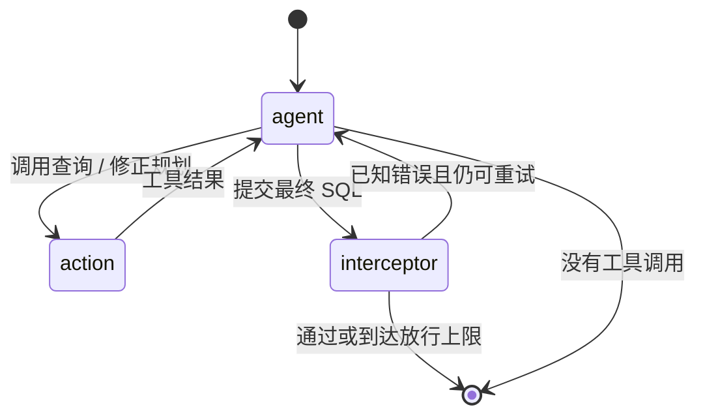

# 架构与实现

## 问题与输入输出

业务问题除了 SQL 语法，还涉及时间范围、用户口径、跨表 ID 和数值格式。Agent 接收包含 `sql_id`、`question`、`table_list`、`knowledge` 的任务，返回 `sql_id`、最终 `sql` 及数据库执行得到的 `result`。

公开演示与本地比赛模式使用同一套核心代码。两种模式仅替换输入资料、答案与错误样本、数据库名称和输出位置。

设计背景与知识维护流程见[方案解读](solution.md)，文件与模块的对应关系见[模块索引](source-map.md)。

## 上下文构造

`SchemaRetriever` 按 `table_list` 从 JSON 中提取相关表结构。`PromptBuilder` 合并题目、特定知识、逐题逻辑指引、表结构和通用规则。

逐题指引存储在 `logic_guides.json`，可以人工维护，也可通过 `generate_logic_guide.py` 从已有参考 SQL 中提取。通用规则包含日期处理、去重、留存和输出字段顺序等业务经验。

## 图流程与工具

- `execute_sql_tool`：执行 StarRocks SQL，保存 SQL、结果或错误日志。
- `revise_plan`：记录新的处理计划，再继续生成。
- `submit_final_sql`：声明最终 SQL，交给拦截器处理。

图流程不产生工具调用就会结束，但外层在提取不到最终提交时仍会把任务判为失败。提交成功后，外层强制重新执行最终 SQL，不从历史消息中猜测最终结果。

## 两层反馈

**执行反馈**：PyMySQL 捕获 SQL 错误，以统一错误前缀交回 Agent。模型可以根据报错修正查询，也可以先执行小样本查询确认字段与值。

**结果反馈**：已知错误样本会转成可比较指纹。当前规则忽略行顺序和字段名，保留列值顺序，并把值转为字符串。拦截器在工具历史中寻找同一 SQL 的执行结果，再与该题的错误样本比较。

已知空结果也参与指纹比较。拦截器根据执行历史与已知错误样本返回反馈，并通过失败计数控制重试流程。

### 提交分支的精确行为

| 条件 | 返回与后续行为 |
| --- | --- |
| 该题没有错误样本 | 跳过结果黑名单比较 |
| 没有找到同一 SQL 的执行历史 | 跳过比较；图结束后的最终 SQL 仍需重执行 |
| 命中错误，第 1 至 4 次失败 | 返回错误工具消息，重新进入 Agent |
| 第 5 次失败 | 返回要求换思路的提示，再进入 Agent |
| 第 6 次及之后仍失败 | 历史实现强制放行并结束图流程 |
| 未命中错误样本 | 返回成功工具消息，并重置该题失败计数 |

侦察查询与规划变更通过 Prompt 和工具协议组织。需要观察第 1 次拦截后的控制流，可运行[固定工具序列回放](walkthrough.md)。

## 缓存、并发与存储

- 缓存中保存的是参考 SQL；每次命中仍查询当前数据库，而不是照抄历史结果。
- `--cache_only` 不构造模型客户端；`--ignore_cache` 强制模型重新生成。
- `ThreadPoolExecutor` 可并发模型任务；`DB_LOCK` 把 SQL 执行串行化。
- `FILE_LOCK` 保护同一进程的结果写入，按 `sql_id` 更新 JSON。
- 逐步日志与输出默认放在 `output/<profile>/`；它们不纳入版本控制。

## 配置与运行入口

`config.py` 统一读取模型、数据库和数据模式配置。公开示例使用 `demo`，本地比赛资料使用 `competition`，各自拥有独立的数据库与输出目录。

模型重新生成、缓存执行和固定工具序列回放分别通过 `--ignore_cache`、`--cache_only` 与 `scripts/replay_demo.py` 进入。运行命令见[复现文档](reproduction.md)。
