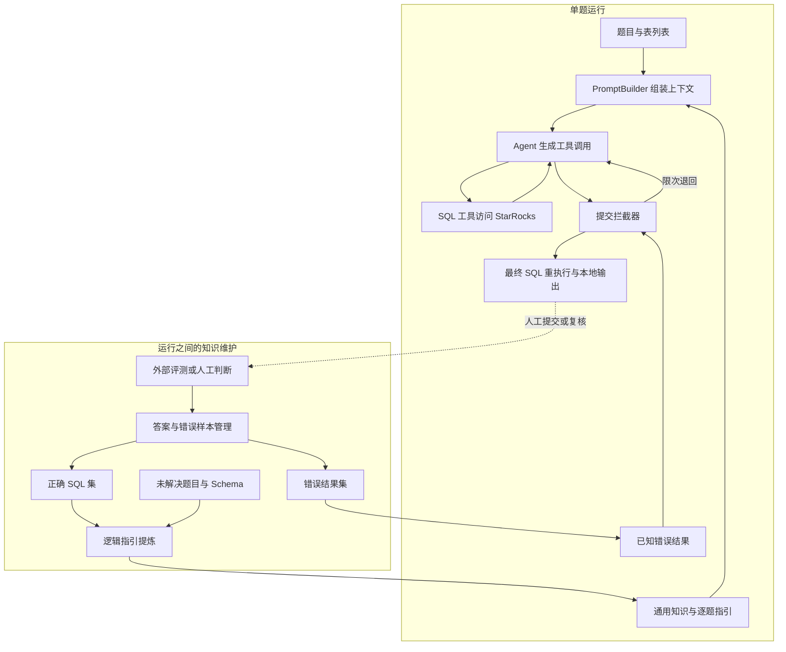

# 方案设计：混合式语境工程

这份说明介绍设计选择与知识来源。阅读代码细节可接着看[架构与实现](architecture.md)，实际观察执行闭环可看[逐步演示](walkthrough.md)，文件与模块的对应关系见[模块索引](source-map.md)。

## 为什么选择 Agent 与语境工程

原始方案面对 15 条 Golden SQL 参考样本，以及混合的全量 Mock 数据。数据中的噪声和非连续记录，使业务口径和查询条件的验证成为关键环节。

这促使方案把重点放在推理时可修改的业务知识与可查询的数据库上。已有 SQL 用来提炼业务口径，真实查询用来验证假设，执行错误和已知错误结果用来推动修正。业务规则调整时可以修改指引，再重新运行。

## 三个问题对应的设计

| 问题 | 容易出现的错误 | 采用的机制 |
| --- | --- | --- |
| 真实数据特征不明确 | 假定日期连续、ID 格式一致，遗漏过滤条件 | 提示先查询日期、ID 和小样本数据 |
| 业务口径需要补充 | 留存定义、关联方式或标签日期错误 | 注入通用知识、题目知识和逐题 Logic Guide |
| 反复得到相同的错误结果 | SQL 改了写法，却仍返回已知错误值 | 结果指纹黑名单与限次换思路提示 |

### 先侦察，再构建与修正

提示词要求先用 1 至 2 个简单查询观察数据，例如查看日期、玩家 ID 或字段样本，再尝试完整 SQL。这样能够较早发现空值、格式差异和与题目无关的数据。

“先侦察”通过 Prompt 中的任务协议传递给模型。`agent`、`action`、`interceptor` 三个节点分别处理模型调用、工具执行和提交检查。

### 用业务指引补充字段语义

同一张活动表可以支持活跃、留存、流失等不同问题，Schema 只能说明字段，不能自动补全所有业务定义。`PromptBuilder` 会把问题、特定知识、逐题指引、相关表结构与通用规则放入同一上下文。

以公开自造题为例，`sql_1` 的逻辑指引要求同时过滤活动日期和标签快照日期，再按玩家关联。这个约束会直接影响结果，即使没有数据库语法错误也可能被遗漏。`sql_2` 的指引则要求保留基准日未留存的玩家，并对玩家 ID 去重。

当前 Prompt 将逐题指引设为高优先级。指引按题目 ID 保存，便于逐题维护业务定义和查询约束。

### 把执行反馈和错误结果反馈分开

`SqlExecutorTool` 将执行异常返回给 Agent，适合修复字段不存在、函数不兼容等问题。拦截器处理的是另一类情况：SQL 成功执行，但结果与已知错误样本相同。

结果指纹忽略字段名与行顺序，保留列值顺序。比如换了别名、改变返回行的排列，仍能匹配同一错误样本。

## 运行时流程与知识维护流程

上半部分由运行程序完成。下半部分通过外部评测或人工复核获得判断，再使用管理工具更新答案与知识资料。

## Logic Guide 的来源

| 来源 | 工具处理 | 产物的含义 |
| --- | --- | --- |
| 已有 Golden SQL 或已标注正确的 SQL | 逆向分析条件、关联和聚合口径 | 从参考解法归纳出的业务规则 |
| 待分析任务 | 根据问题、Schema 和特定知识做先验分析 | 解题思路与数据处理要点 |
| 人工数据侦察 | 根据查询发现格式、空值或取值约束，再维护指引 | 对当前数据环境的观察，数据变化后需要复查 |

`generate_logic_guide.py` 实现前两类模板，`--mode golden`、`correct`、`unsolved`、`ids` 等参数决定处理范围。人工探查可使用数据库客户端或 SQL 工具完成。

根据外部评测或复核结论，使用 `manage_answers.py` 的 `add_correct` 和 `import_error` 分别录入正确答案与错误样本。

## 提交策略

前 4 次命中已知错误时返回错误反馈。第 5 次额外提示更换思路；第 6 次仍命中时，按重试上限放行结束。图流程结束后，外层重执行最终 SQL，保存当前数据库返回的实际结果。
