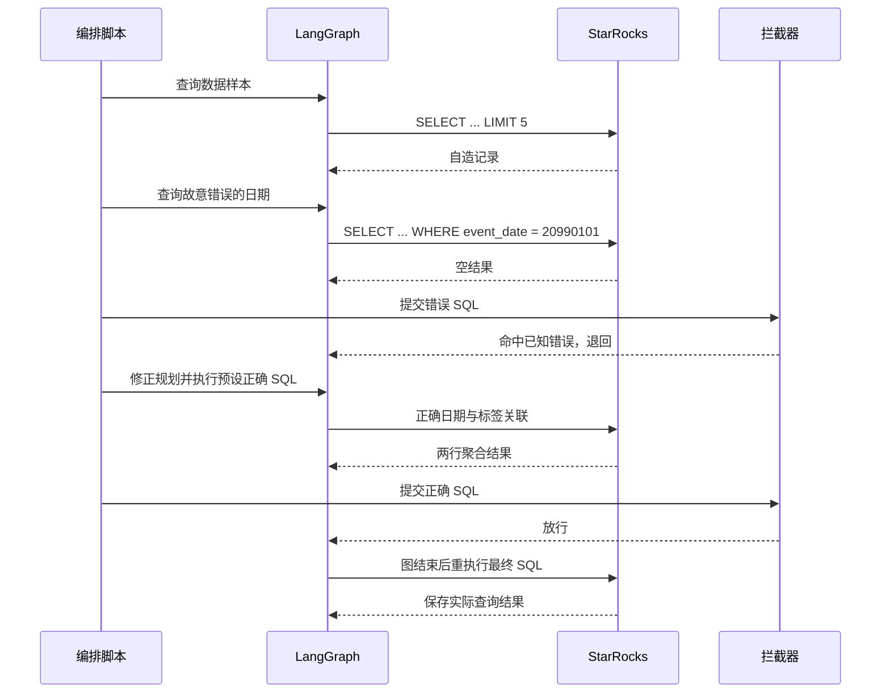

# 逐步演示：错误结果被拦截后发生什么

这份演示把公开自造的 `sql_1` 放入真实 LangGraph 流程，先运行一条故意使用错误日期的 SQL，再提交修正后的查询。工具选择和 SQL 由脚本预先编排，数据库查询、黑名单检查与最终重执行使用仓库现有实现。

固定工具序列可在无需 API 密钥的情况下运行。模型生成使用 README 中的 `--ignore_cache` 命令。

## 运行

先按[复现文档](reproduction.md)安装依赖，启动并初始化 demo 数据库。已经完成初始化时直接运行：

```bash
python scripts/replay_demo.py
python scripts/verify_demo.py --file output/demo/replay_result.json --ids sql_1
```

脚本只允许 `TGAC_PROFILE=demo`。输出为 `output/demo/replay_trace.json` 和 `output/demo/replay_result.json`，逐步执行日志留在本地。仓库附有一次已核验的[自造数据轨迹示例](../examples/replay_trace.json)。

## 题目与上下文

题目要求统计 **2026 年 1 月 1 日，标签为 `returning` 的玩家在当天各游戏的游玩总分钟数**。输出列依次为 `game_id`、`total_minutes`。

上下文包括两张表：活动表 `demo_sessions` 与每日标签表 `demo_player_tags`。指引要求按玩家关联，同时约束活动日期和标签快照日期。演示数据为独立编写的示例记录。

## 六个工具调用

| 步骤 | 工具与操作 | 实际观察 |
| --- | --- | --- |
| 1 | `execute_sql_tool` 查看按日期与玩家排序的 5 行样本 | 得到日期、玩家、游戏和分钟数 |
| 2 | 执行故意筛选 `20990101` 的聚合 SQL | 返回 `[]`，SQL 本身没有执行错误 |
| 3 | `submit_final_sql` 提交这条错误 SQL | 空结果命中 `sql_1` 的已知错误样本，拦截器退回 |
| 4 | `revise_plan` 声明改用题目日期，并关联对应快照标签 | 记录修正计划 |
| 5 | 执行预先准备的正确 SQL | 返回 `g_alpha: 75` 与 `g_beta: 60` |
| 6 | `submit_final_sql` 提交正确 SQL | 未命中已知错误，结束图流程 |

图结束后，外层再执行一次最终 SQL，然后把实际返回值保存到结果文件。因此总计 **6 次工具调用、4 次数据库查询**，最后一次查询属于图外的最终重执行。



## 正确 SQL 的关键约束

```sql
SELECT s.game_id, SUM(s.play_minutes) AS total_minutes
FROM demo_sessions s
JOIN demo_player_tags t
  ON s.player_id = t.player_id
 AND t.snapshot_date = '20260101'
WHERE s.event_date = '20260101'
  AND t.player_segment = 'returning'
GROUP BY s.game_id
ORDER BY s.game_id;
```

关联正确还不够：漏掉快照日期可能连接不同日期的标签；漏掉 `returning` 则改变统计人群。这个例子用于说明语法反馈与业务结果反馈为什么不同。

## 结果与日志

运行后可在轨迹文件中查看已知空结果的拦截反馈、规划变更、修正后的 SQL 和最终结果。校验脚本将输出与示例答案比较，并打印 `[PASS] sql_1`。提交分支与重试策略见[架构说明](architecture.md)。
